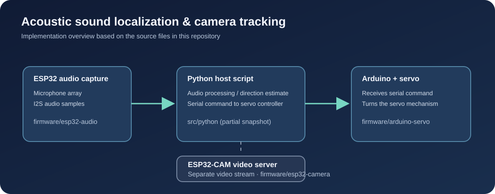
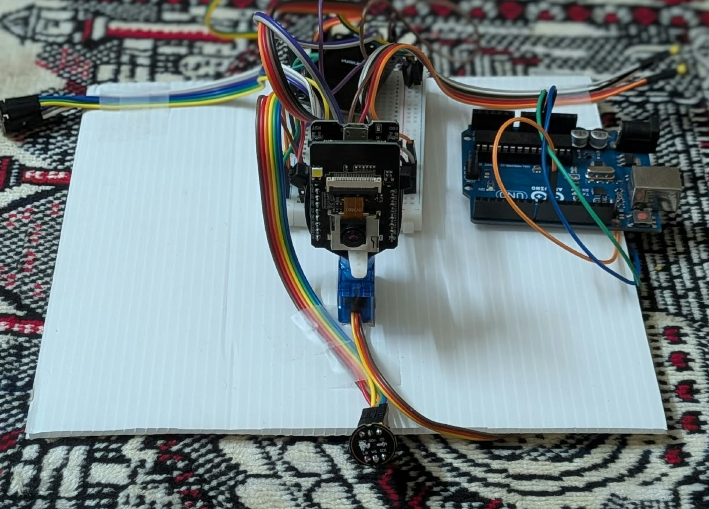
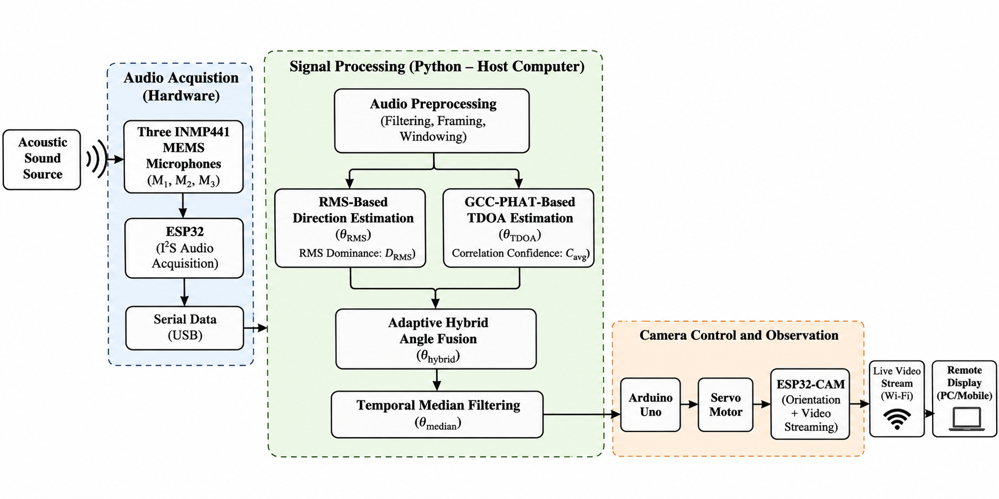
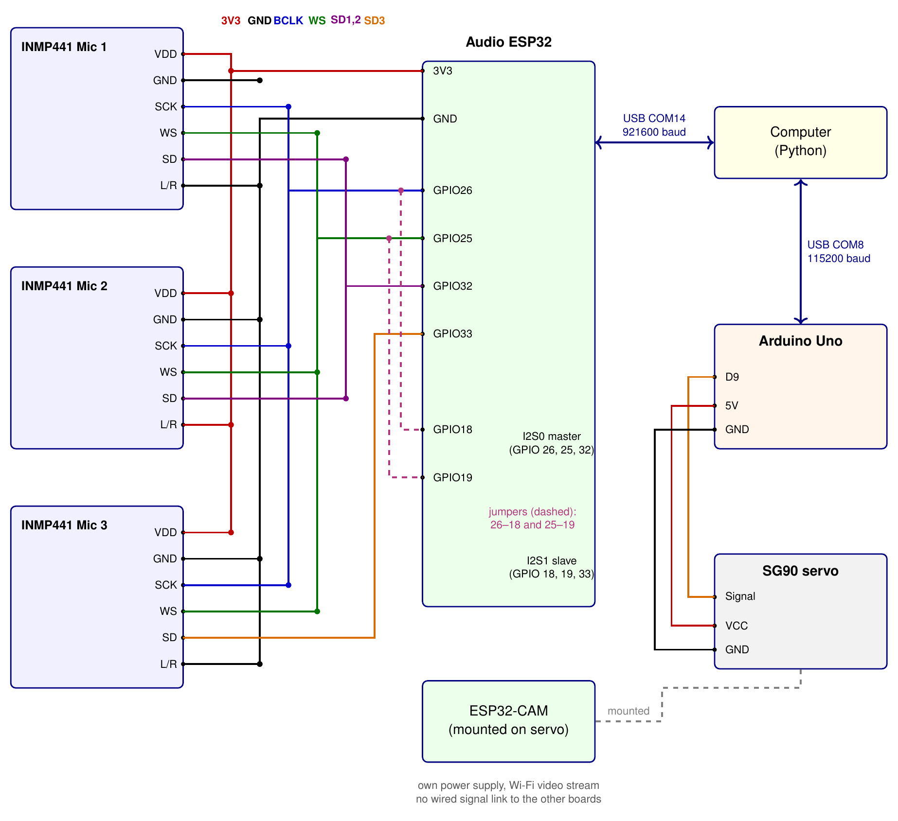
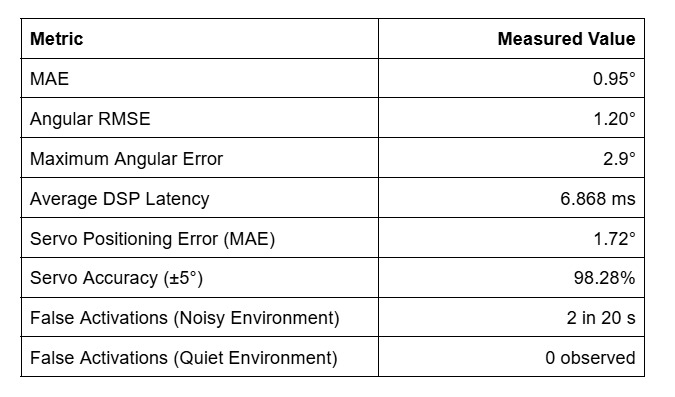
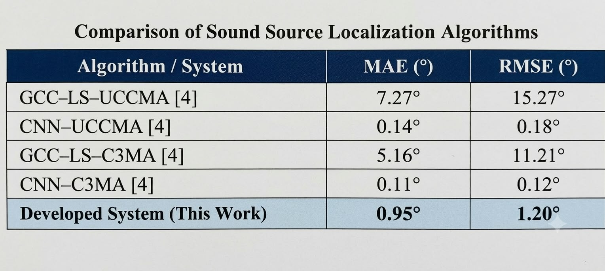

# Hybrid RMS and GCC-PHAT Based Acoustic Sound Localization With Camera Tracking

An embedded Digital Signal Processing (DSP) system designed to estimate the direction of an incoming sound source using a three-microphone array and automatically orient a camera toward the estimated direction.

The proposed system combines **Root Mean Square (RMS) amplitude analysis** and **Generalized Cross-Correlation with Phase Transform (GCC-PHAT)** to estimate the Direction of Arrival (DOA) of sound. An adaptive hybrid fusion mechanism combines both localization techniques, followed by temporal median filtering to improve angular stability.

The implementation integrates ESP32-based audio acquisition, Python-based signal processing, Arduino-controlled servo positioning, and ESP32-CAM video streaming.

## System Overview

The complete system consists of three major stages:

- **Audio Acquisition:** Three INMP441 MEMS microphones capture acoustic signals, which are acquired by the ESP32 through I2S.
- **Signal Processing:** A Python application performs audio preprocessing, RMS-based localization, GCC-PHAT-based TDOA estimation, adaptive angle fusion, and temporal median filtering.
- **Camera Control and Observation:** The estimated direction is communicated to an Arduino Uno, which controls an SG90 servo motor. The ESP32-CAM independently provides a live video stream over Wi-Fi.



## Hardware Implementation

The prototype integrates the microphone array, ESP32 audio acquisition, Arduino-based servo control, and ESP32-CAM video streaming.



## System Architecture

The following block diagram illustrates the complete signal flow, from acoustic signal acquisition to camera positioning and live video observation.



## Hardware Components

- ESP32 Development Board
- Three INMP441 Digital MEMS Microphones
- Arduino Uno
- SG90 Servo Motor
- ESP32-CAM Module
- Host Computer
- USB Serial Communication

## Circuit Diagram

The circuit diagram illustrates the microphone connections to the ESP32, serial communication with the host computer, and Arduino-based servo control.



## Microphone Array Configuration

The system uses three INMP441 digital MEMS microphones arranged in a circular configuration.

- Number of microphones: 3
- Microphone array radius: 7.5 cm
- Sampling frequency: 16 kHz
- Frame size: 2048 samples
- Frame duration: 128 ms
- Audio interface: I2S
- Localization range: 0°–180°

The microphones capture acoustic signals from different spatial positions. Differences in received signal amplitudes and arrival times are used to estimate the direction of the incoming sound.

## Working Methodology

### 1. Audio Acquisition

Three INMP441 digital MEMS microphones capture the incoming acoustic signals.

The ESP32 acquires microphone data through the I2S interface and transfers the sampled audio data to the host computer through USB serial communication.

### 2. Audio Preprocessing

The acquired audio signals undergo preprocessing before localization. This stage includes filtering, framing, and windowing.

### 3. RMS-Based Direction Estimation

Root Mean Square (RMS) analysis estimates the relative signal strength received by each microphone.

The RMS value is calculated as:

\[
RMS = \sqrt{\frac{1}{N}\sum_{n=1}^{N}x[n]^2}
\]

The relative RMS values are used to estimate the direction of the incoming sound source.

### 4. GCC-PHAT-Based TDOA Estimation

Generalized Cross-Correlation with Phase Transform (GCC-PHAT) estimates the Time Difference of Arrival (TDOA) between microphone signals.

The GCC-PHAT function is expressed as:

\[
R_{ij}(\tau)=
\mathcal{F}^{-1}
\left[
\frac{X_i(f)X_j^*(f)}
{|X_i(f)X_j^*(f)|}
\right]
\]

The correlation peak provides an estimate of the relative time delay between microphone pairs. These delay estimates are used to calculate the corresponding direction of arrival.

### 5. Adaptive Hybrid Angle Fusion

The RMS and GCC-PHAT methods provide complementary localization estimates.

An adaptive weighted fusion approach combines the two estimates. The contribution of each technique is determined using RMS dominance and a GCC-PHAT correlation confidence index.

This produces the final hybrid direction estimate.

### 6. Temporal Median Filtering

A temporal median filtering stage is incorporated to mitigate instantaneous fluctuations in the estimated direction and improve output stability.

### 7. Camera Positioning and Video Streaming

The filtered direction estimate is communicated to the Arduino Uno through serial communication.

The Arduino controls the SG90 servo motor to orient the camera toward the estimated direction.

The ESP32-CAM operates independently as a video streaming unit, providing a live MJPEG stream over Wi-Fi.

## Experimental Results

The developed system was evaluated using angular localization accuracy, processing latency, servo positioning accuracy, and false activation measurements.

### Measured Performance

The following image presents the experimentally measured performance of the developed system.



The system achieved a mean angular error of **0.95°**, an angular RMSE of **1.20°**, and an average DSP processing latency of **6.868 ms**.

The measured servo positioning error was **1.72°**, with **98.28% accuracy within ±5°**.

### Comparison with Existing Localization Algorithms

The developed system was compared with localization algorithms reported in the referenced study.



The developed system achieved an experimental MAE of **0.95°** and an angular RMSE of **1.20°**.

*Note: The reported comparison methods and the developed system may have been evaluated under different experimental conditions. The results should therefore be interpreted as a comparison of reported performance rather than a controlled head-to-head benchmark.*

## Repository Structure

```text
Acoustic-Sound-Localization/
│
├── Firmware/
│   ├── Arduino.ino
│   ├── ESP32.ino
│   └── ESP32CAM.ino
│
├── src/
│   └── algorithm.py
│
├── docs/
│   └── images/
│       ├── block.png
│       ├── circuit.png
│       ├── comparison.png
│       ├── metric.png
│       ├── setup.png
│       └── system-overview.svg
│
├── .gitignore
└── README.md
```

## Software Requirements

- Python 3
- Arduino IDE
- ESP32 Arduino Board Package

### Python Dependencies

The Python signal processing implementation uses the following libraries:

- NumPy
- SciPy
- Matplotlib
- PySerial

Install the dependencies using:

```bash
pip install numpy scipy matplotlib pyserial
```

## Getting Started

### 1. Clone the Repository

```bash
git clone https://github.com/YOUR_USERNAME/YOUR_REPOSITORY.git

cd YOUR_REPOSITORY
```

Replace the repository URL with your actual GitHub repository URL.

### 2. Upload ESP32 Firmware

1. Open `Firmware/ESP32.ino` in Arduino IDE.
2. Install the ESP32 board package if required.
3. Select the appropriate ESP32 development board.
4. Verify the microphone pin configuration.
5. Upload the firmware.

### 3. Run Python Localization

1. Connect the ESP32 to the host computer through USB.
2. Install the required Python dependencies.
3. Open `src/algorithm.py`.
4. Verify the serial port and baud rate configuration.
5. Execute the program:

```bash
python src/algorithm.py
```

### 4. Configure Arduino Servo Control

1. Open `Firmware/Arduino.ino` in Arduino IDE.
2. Verify the serial communication and servo pin configuration.
3. Connect the Arduino Uno and SG90 servo motor.
4. Upload the sketch.

### 5. Configure ESP32-CAM

1. Open `Firmware/ESP32CAM.ino`.
2. Configure the required Wi-Fi credentials.
3. Select the appropriate ESP32-CAM board.
4. Upload the firmware.
5. Access the live video stream using the configured network address.

## Applications

- Acoustic source localization
- Sound-directed camera positioning
- Smart surveillance systems
- Acoustic monitoring systems
- Human voice direction estimation
- Embedded intelligent sensing systems

## Future Improvements

- Improved localization in noisy and reverberant environments.
- Near-field sound source localization.
- Multi-source acoustic localization.
- Improved synchronization and real-time processing.
- Integration of visual object detection.
- Extended testing across different acoustic environments.

## Technologies Used

Python · NumPy · SciPy · ESP32 · INMP441 · Arduino · ESP32-CAM · I2S · RMS · GCC-PHAT · TDOA · Digital Signal Processing

## Author

**Abhay Arakkal**

Electronics and Communication Engineering  
Model Engineering College, Thrikkakara, Kerala, India

---

This project explores the integration of digital signal processing, embedded systems, acoustic sensing, and camera positioning to develop a hybrid sound localization system.
